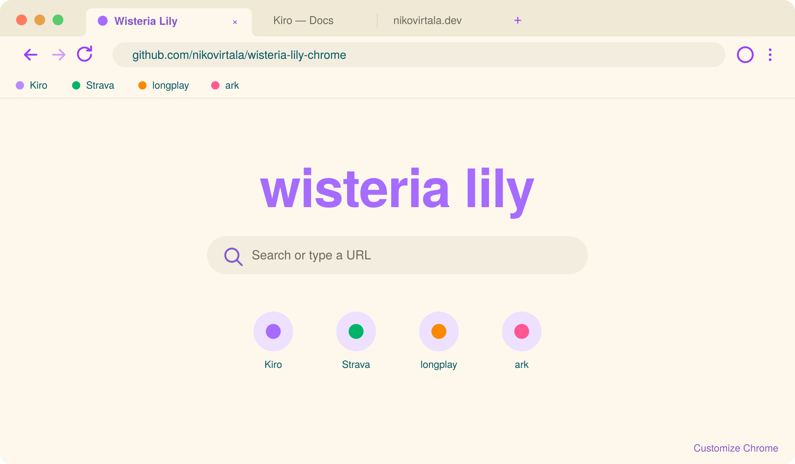

# Wisteria Lily for Chrome

A warm light Chrome theme. Wisteria purple (`#A66BFF`) accents sit on a Day Lily
cream (`#FEF8EC`) background. It's the browser companion to
[Wisteria Lily](https://github.com/nikovirtala/wisteria-lily) for Kiro and VS Code,
so your editor and your browser can finally hold hands.



## Install

The theme isn't in the Chrome Web Store, so you load it as an unpacked extension.

1. Get the files:

   ```sh
   git clone https://github.com/nikovirtala/wisteria-lily-chrome.git
   ```

   Or download the ZIP from GitHub (**Code → Download ZIP**) and unzip it.

2. Open `chrome://extensions`.
3. Turn on **Developer mode** (top-right toggle).
4. Click **Load unpacked** and select the `wisteria-lily-chrome` folder (the one
   with `manifest.json` in it).

The theme applies immediately. Keep the folder where it is: Chrome reads the theme
from that folder.

### Make it look right

- **Light mode.** The theme is designed for light mode. Open the side panel from
  **Customize Chrome** on the New Tab page (or **Settings → Appearance → Mode**)
  and pick **Light**. In Dark or Device mode, Chrome draws its own dark menus and
  panels against the cream frame.
- **Purple Google logo.** The theme asks for a single-color logo on the New Tab
  page and tints it wisteria purple.

### Update

```sh
git pull
```

Then click the reload icon on the Wisteria Lily card in `chrome://extensions`.

### Uninstall

**Settings → Appearance → Theme → Reset to default**, or remove the extension in
`chrome://extensions`.

## Color mapping

Every color comes from the Kiro/VS Code theme. The table maps Chrome's theme keys
to the editor colors they borrow from.

| Chrome key | Color | From the editor theme |
| --- | --- | --- |
| `frame` | `#F0E9D6` | `editorGroupHeader.tabsBackground` |
| `frame_inactive` | `#F9F1E1` | `titleBar.inactiveBackground` |
| `background_tab` | `#F0E9D6` | `tab.inactiveBackground` |
| `background_tab_inactive` | `#F9F1E1` | `titleBar.inactiveBackground` |
| `toolbar` | `#FEF8EC` | `editor.background` / `tab.activeBackground` |
| `tab_text` | `#8556CC` | `banner.iconForeground` |
| `tab_background_text` | `#6B675C` | `tab.inactiveForeground`, darkened |
| `tab_background_text_inactive` | `#706C60` | `tab.inactiveForeground`, darkened |
| `toolbar_button_icon` | `#973CFF` | `badge.background` |
| `toolbar_text`, `bookmark_text` | `#005661` | `editor.foreground` |
| `omnibox_background` | `#F2EDDE` | `editorWidget.background` |
| `omnibox_text` | `#005661` | `editor.foreground` |
| `ntp_background` | `#FEF8EC` | `editor.background` |
| `ntp_text` | `#005661` | `editor.foreground` |
| `ntp_link` | `#8556CC` | `banner.iconForeground` |
| `ntp_header` | `#EDE1FF` | `statusBarItem.activeBackground` |
| `ntp_logo` | `#A66BFF` | `editorCursor.foreground` |
| `frame_incognito` | `#003B42` | `terminal.ansiBlack` |
| `frame_incognito_inactive` | `#004D57` | `terminal.ansiBrightBlack` |
| `tab_background_text_incognito` | `#BBC3C4` | `terminal.ansiBrightWhite` |
| `tab_background_text_incognito_inactive` | `#A8BABA` | `terminal.ansiWhite`, lightened |

Incognito windows get a deep teal frame taken from the terminal palette, so you can
tell at a glance which window you're in.

### Contrast

All text meets WCAG 2 AA (4.5:1) against its background, and toolbar icons and the
New Tab logo meet the 3:1 non-text minimum. Where an editor color was too pale for
Chrome's small tab titles, the theme uses a darker sibling from the same palette.
Check after any color change:

```sh
./scripts/contrast.py
```

## Develop

1. Edit `manifest.json`. Colors are `[R, G, B]` arrays. Run `./scripts/contrast.py`.
2. Reload the extension in `chrome://extensions`.

The icon and the preview are drawn in `assets/*.svg`. To re-render them:

```sh
for s in 16 48 128; do rsvg-convert -w $s -h $s assets/icon.svg -o icons/icon$s.png; done
rsvg-convert -w 1920 assets/preview.svg -o assets/preview.png
```

[GoogleChromeThemeCreationGuide](https://github.com/Patrick-Batenburg/GoogleChromeThemeCreationGuide)
documents the theme keys.

## License

[MIT](LICENSE)
